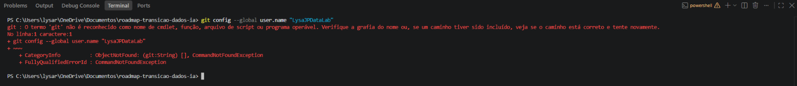
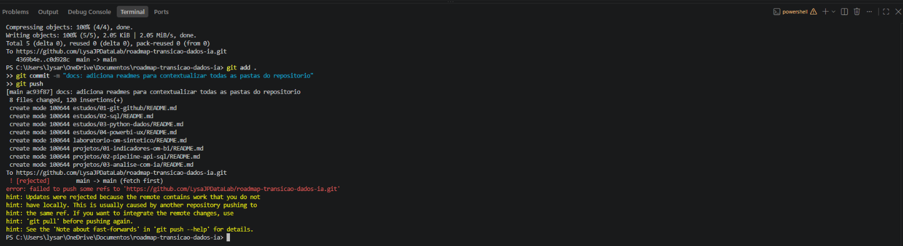
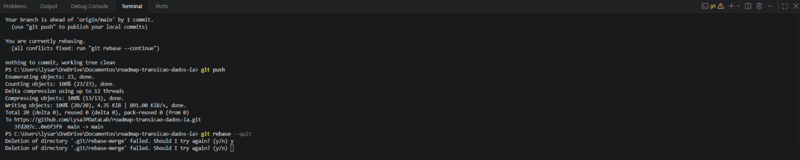

# 🛠️ Troubleshooting e Lições Aprendidas — Git & GitHub

Registro de erros reais encontrados durante a configuração e os primeiros envios do repositório, com causa raiz e solução aplicada.

---

## 1. Comando `git` não reconhecido no PowerShell do VS Code
* **Erro:** `O termo 'git' não é reconhecido como nome de cmdlet, função, arquivo de script ou programa operável.`
* **Causa raiz:** O Git não estava instalado no Windows ou o VS Code já estava aberto durante a instalação e não carregou a nova variável de ambiente (`PATH`).
* **Solução:** Instalar o Git para Windows (mantendo a opção de adicionar ao PATH) e reiniciar completamente o VS Code.
* **Verificação:** Rodar `git --version` e confirmar o retorno da versão instalada.


*Figura 1: Erro exibido no PowerShell do VS Code antes de reiniciar o editor.*

---

## 2. Push rejeitado por divergência com o repositório remoto
* **Erro:** `! [rejected] main -> main (fetch first)` / `Updates were rejected because the remote contains work that you do not have locally.`
* **Causa raiz:** O repositório no GitHub possuía alterações (como edições diretas pelo navegador) que ainda não existiam no histórico local.
* **Solução:** Sincronizar o histórico local antes de enviar novamente:
  ```powershell
  git pull --rebase origin main
  git push
* **Prevenção:** Sempre rodar `git pull` antes de começar a editar arquivos localmente caso tenha feito alguma alteração direto no site do GitHub.


*Figura 2: Erro ao tentar realizar o pull.*

---

## 3. Falha ao deletar diretório durante o `rebase`
* **Erro:** `Deletion of directory 'estudos/02-sql' failed. Should I try again? (y/n)`
* **Causa raiz:** O Windows travou a pasta enquanto o Git tentava reorganizar os arquivos. Os responsáveis foram a sincronização ativa do OneDrive e os arquivos abertos nas abas do VS Code.
* **Solução:**
1. Digitar `n` para interromper o loop no terminal.
2. Pausar a sincronização do OneDrive e fechar todas as abas abertas no VS Code.
3. Verificar o estado com `git status` e concluir o envio com `git push`.
* **Prevenção:** Evitar manter repositórios Git dentro de pastas sincronizadas pelo OneDrive (preferir caminhos locais como `C:\Projetos\`).


*Figura 3: Erro ao tentar deletar diretório.*

---

## 4. Rebase preso com erro ao apagar `.git/rebase-merge`
* **Erro:** `Deletion of directory '.git/rebase-merge' failed ao tentar rodar git rebase --quit.`
* **Causa raiz:** A integração interna do Git no VS Code manteve o diretório temporário de rebase bloqueado no sistema operacional.
* **Solução:** Fechar completamente o VS Code e remover a pasta temporária manualmente pelo PowerShell do Windows:
  ```powershell
  Remove-Item -Recurse -Force ".\.git\rebase-merge"
* **Verificação:** Reabrir o VS Code e confirmar com `git status` que o aviso `You are currently rebasing` desapareceu.


*Figura 4: Erro ao tentar deletar diretório.*