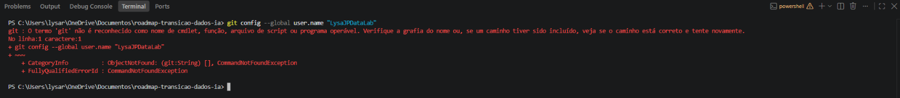
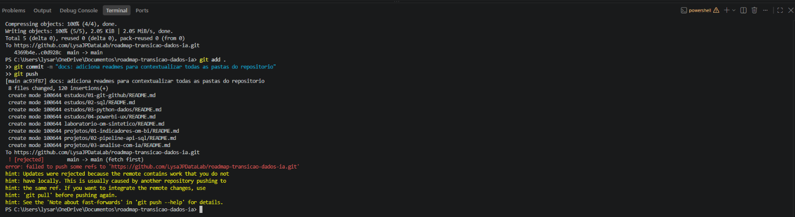

# 🖼️ Guia Completo: Imagens e Legendas em Markdown

Aprenda a estruturar, organizar e formatar imagens nos seus arquivos de documentação Markdown (`.md`) para garantir que seus registros fiquem claros e visualmente profissionais.

---

## 1. 📂 Estrutura de Caminhos de Arquivo

Para garantir que o GitHub carregue as imagens corretamente, coloque-as dentro de uma pasta dedicada (ex: `assets/`) no mesmo diretório do arquivo `.md`.

* **Caminho Relativo Simples (Recomendado):**
  ```markdown
  assets/nome-da-imagem.png
  ```
* **Caminho Relativo Explícito:**
  ```markdown
  ./assets/nome-da-imagem.png
  ```
  *Nota: O `./` indica "nesta mesma pasta". Evite usar ponto colado na barra como `.assets/`.*

---

## 2. ✍️ Sintaxe Básica em Markdown

A estrutura padrão para inserir imagens é:

```markdown

```

### Componentes:
1. `![ ... ]`: **Texto Alternativo (Alt Text)** — Descrição da imagem usada por leitores de tela e exibida se a imagem não carregar.
2. `( ... )`: **Caminho da Imagem** — Onde o arquivo está localizado.
3. `" ... "`: **Tooltip (Opcional)** — Texto curto exibido quando o usuário passa o mouse por cima da imagem.

---

## 3. 💬 Estilos de Legendas

Como o Markdown nativo não tem uma tag própria para legendas, utilize uma destas estratégias:

### Opção A: Legenda em Itálico (Mais Prática)
Insira a descrição imediatamente na linha abaixo da imagem (sem linha em branco entre elas):

```markdown

*Figura 1: Mensagem de erro exibida no PowerShell antes de reiniciar o VS Code.*
```

### Opção B: Bloco de Destaque / Citação (`>`)
Ideal para quando a legenda contém uma explicação técnica mais longa:

```markdown

> **Diagnóstico:** O repositório remoto continha alterações não sincronizadas no histórico local.
```

### Opção C: HTML Estruturado (`<figure>` e `<figcaption>`)
Garante suporte semântico completo e permite centralizar imagem e texto:

```html
<figure align="center">
  
  <figcaption><em>Figura 1: Erro de comando não reconhecido no terminal.</em></figcaption>
</figure>
```

---

## 4. ⚙️ Ajuste de Tamanho e Alinhamento (via HTML)

Quando a imagem original for muito grande, você pode usar tags HTML inline para controlar dimensões e alinhamento:

### Redimensionar por Largura:
```html

```

### Centralizar Imagem:
```html
<div align="center">
  
</div>
```

---

## 5. ✅ Boas Práticas
* **Nomenclatura sem espaços nem caracteres especiais:** Prefira `01-erro-git.png` em vez de `Erro 01 (Git).png`.
* **Organização:** Mantenha sempre a pasta `assets` ou `imagens` no mesmo nível do documento.
* **Leveza:** Evite imagens excessivamente pesadas (acima de 2 MB); faça o recorte (*crop*) mostrando apenas a área de interesse da tela.